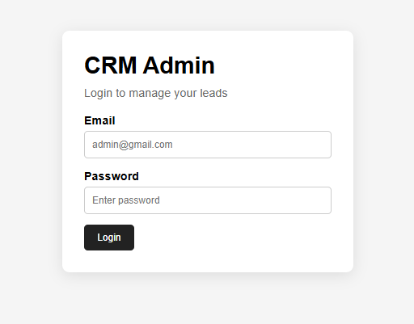
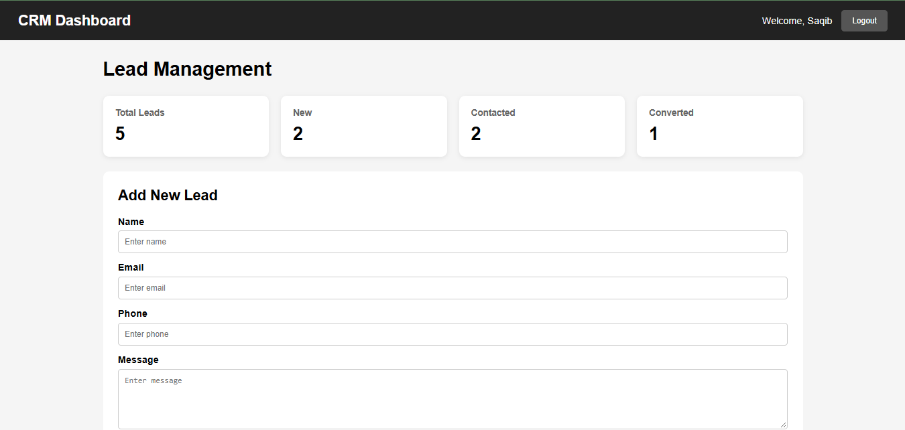
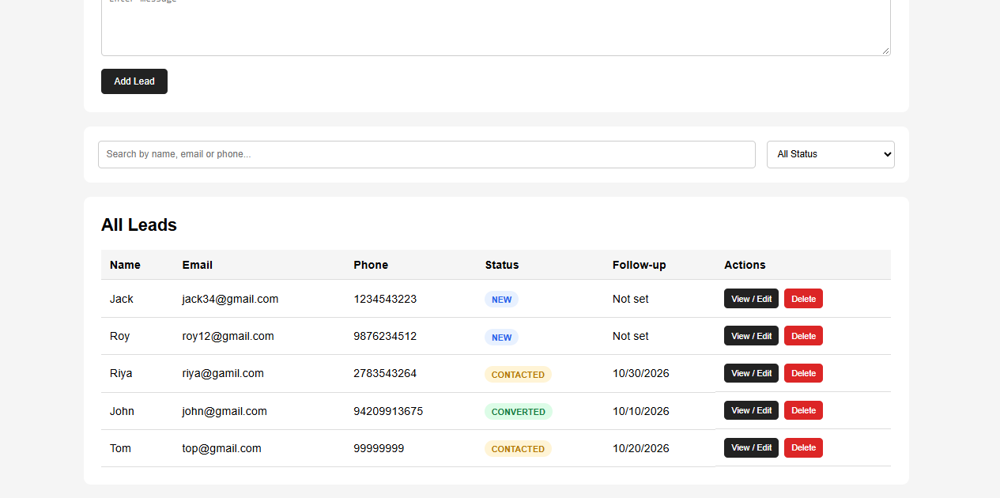
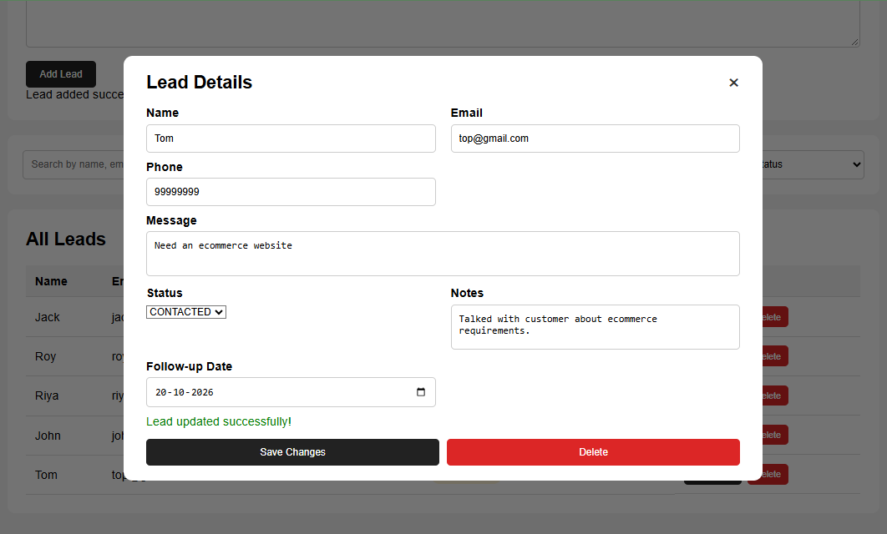

# FUTURE_FS_02 — CRM System

A simple **CRM System** built using the **MERN Stack** to manage leads generated through website contact forms. This project was created as part of the **Future Interns Full Stack Web Development Internship**.

---

## 🚀 Features

- 🔐 Admin Login Authentication
- 🔑 JWT-based Authentication
- 👥 Lead Management
- 📊 Lead Status Tracking
- 📝 Update Lead Information & Internal Notes
- 📅 Follow-up Scheduling & Management
- 📱 Responsive Dashboard
- 🗄️ MongoDB Database with RESTful APIs

---

## 🛠️ Technologies Used

- **Frontend:** React.js, CSS, JavaScript
- **Backend:** Node.js, Express.js
- **Database & ODM:** MongoDB, Mongoose
- **Authentication:** JSON Web Tokens (JWT)

---

## 📸 Screenshots

### 🔐 Admin Login


### 📊 Dashboard


### 👥 Leads List


### 📝 Update / View Lead


---

## 📂 Project Structure

```text
CRM_task_02/
│
├── Screenshots/
│   ├── Admin_login.PNG
│   ├── Leads_list.PNG
│   ├── dashboard.PNG
│   └── update_view_form.PNG
│
├── .gitignore
└── README.md
